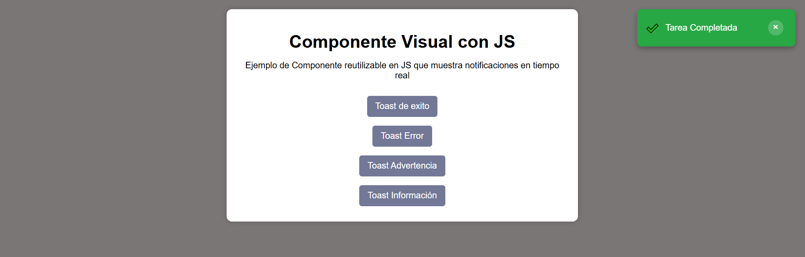
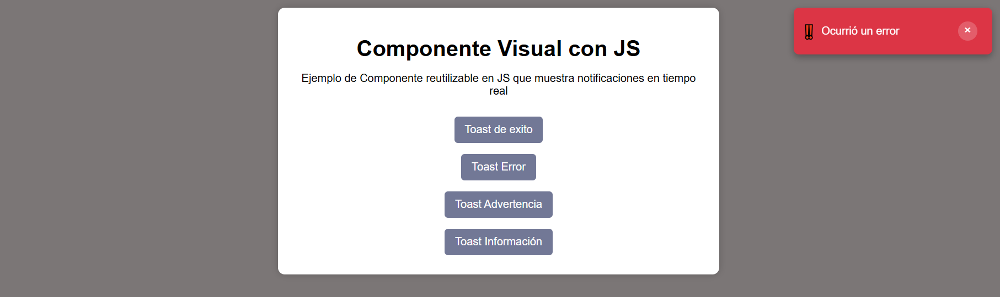
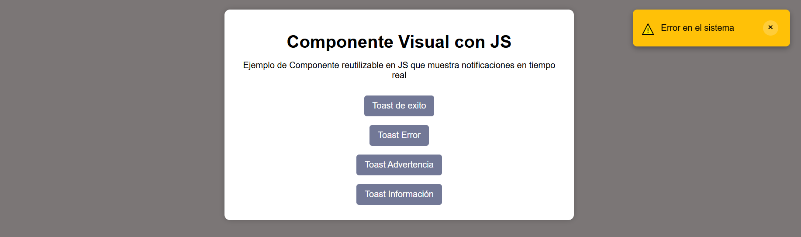
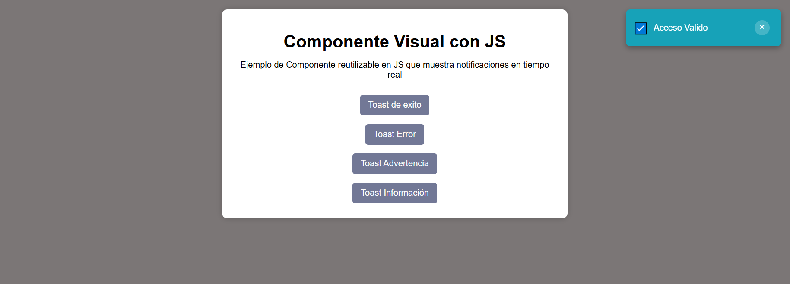
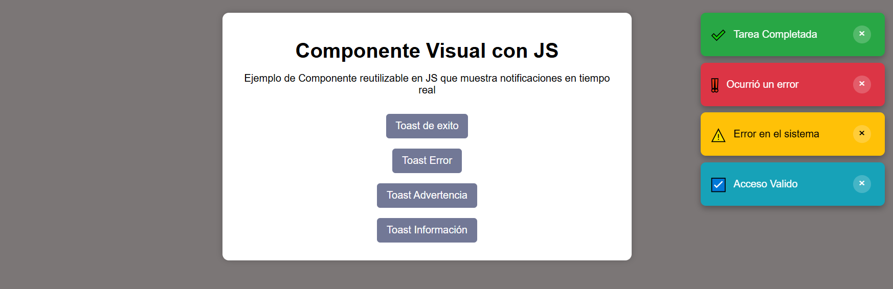
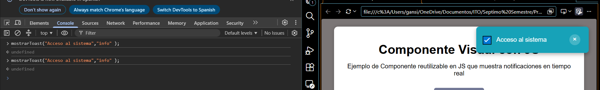

# Instituto Tecnologico de Oaxaca

# Componente Visual con JavaScript

# Componente Toast

## Alumno
Martinez Cruz Gael

## Descripcion
Este proyecto es un componentes visual tipo Toast hecho con JavaScript, que muestra notificaciones temporales al usuario, muestre diferentes tipos como lo es (exito, error, advertencia e informacion), permite cerrar las notificaciones y apilarlas sin tener que reemplazar las anteriores

---

# Instalacion
Para agregar el archivo js y css a el proyecto en el que se implementara

```html
<link rel="stylesheet" href="css/componente.css">
<script src="js/componente.js"></script>
```

---

# Uso del componente

Mostrar notificacion de exito:

```javascript
mostrarToast("Tarea Completada","success");

```
Mostrar un mensaje de error:

```javascript
mostrarToast("Ocurrió un error","error");
```

Mostrar una advertencia:

```javascript
mostrarToast("Error en el sistema","warning");
```

Mostrar un mensaje informativo:

```javascript
mostrarToast("Acceso Valido","info");
```
# Capturas del funcionamiento del componente visual

## Toast de éxito



---

## Toast de error



---

## Toast de advertencia



---

## Toast de información



---

## Varios Toast simultáneos



---

## Captura Consola



# Video del Funcionamiento 

https://youtu.be/lBKBxZBipbE

---


# Tecnologías utilizadas

- HTML5
- CSS3
- JavaScript